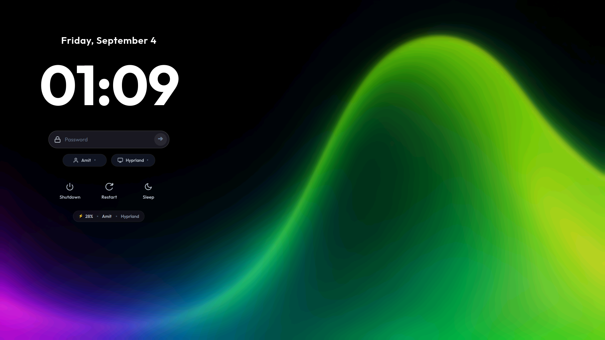
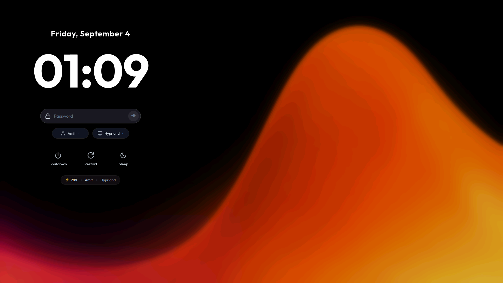
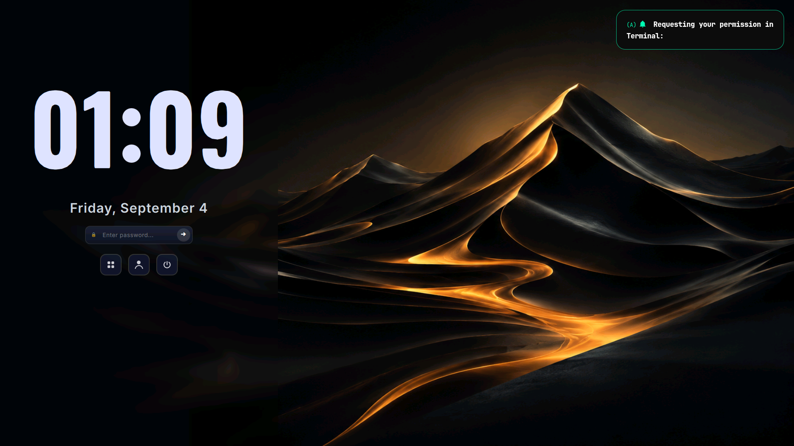
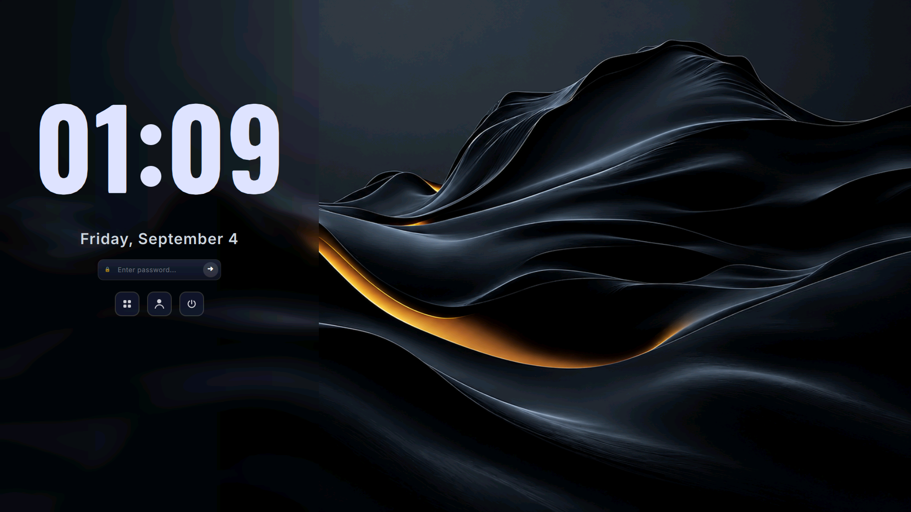
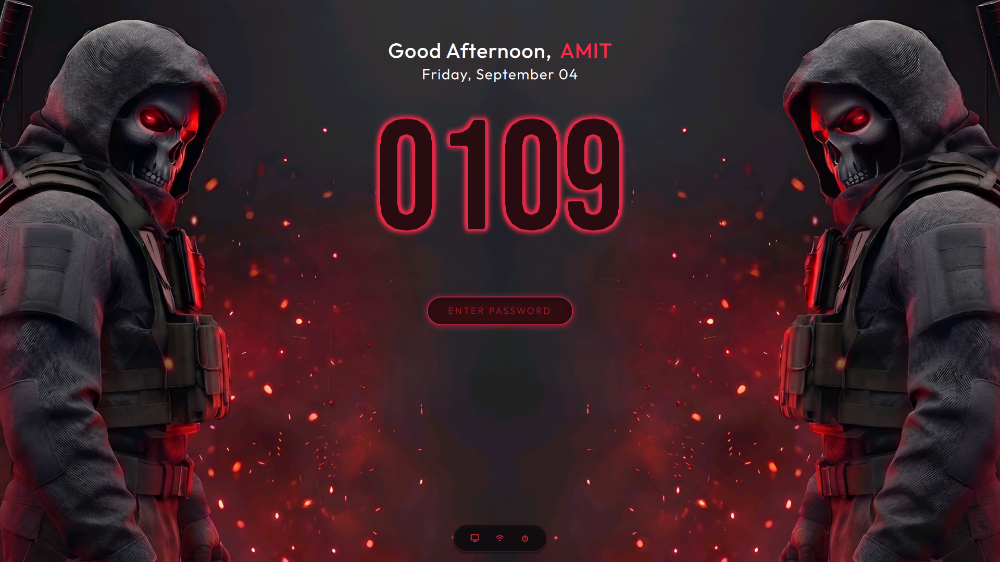
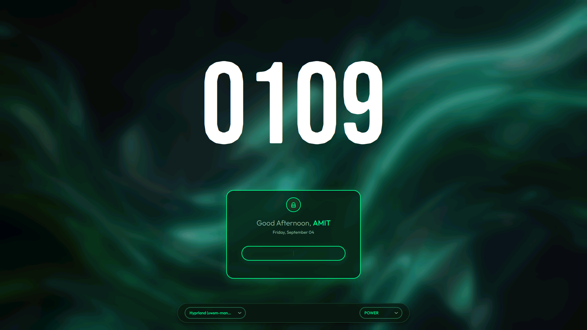

<div align="center">

# 🌌 Modern SDDM Themes Collection

[](https://github.com/amitpadhan525/sddm-themes/stargazers)
[](https://github.com/amitpadhan525/sddm-themes/network/members)
[](https://www.qt.io/)
[](https://github.com/sddm/sddm)
[](https://wayland.freedesktop.org/)
[](LICENSE)

*A curated suite of modern, glassmorphic, and high-contrast SDDM login greeters engineered for Qt6, Wayland, and X11.*

---

⭐ **If you find these themes aesthetic, please star this repository to support future releases!** ⭐

[⚡ Quick Comparison](#-quick-comparison) • [🧪 Live Preview](#-instant-live-preview-no-install-needed) • [🎨 Themes Showcase](#-themes-showcase) • [⚙️ Installation](installation.md) • [🤝 Collaborators](#-collaborators)

</div>

---

## ⚡ Quick Comparison

| Theme | Aesthetic Style | Primary Accent | Key Typography | Live Test Command |
| :--- | :--- | :--- | :--- | :--- |
| **GreenShift** | Cyberpunk Glow | Vivid Green & Charcoal | *Outfit*, *Bebas Neue*, *JetBrainsMono* | `sddm-greeter-qt6 --test-mode --theme GreenShift` |
| **OrangeShift** | Solar Glassmorphic | Amber & Deep Tangerine | *Outfit*, *Bebas Neue*, *JetBrainsMono* | `sddm-greeter-qt6 --test-mode --theme OrangeShift` |
| **Golden Horizon** | Sunset Minimalist | Warm Sunset Gold | Centered Modern Geometric | `sddm-greeter-qt6 --test-mode --theme golden-horizon` |
| **Midnight Current** | Electric Darkwave | Deep Cyan & Navy | High-Contrast Digital Sans | `sddm-greeter-qt6 --test-mode --theme midnight-current` |
| **Phantom Red** | Tactical Gaming | Crimson & Obsidian Smoke | Bold Digital Font | `sddm-greeter-qt6 --test-mode --theme phantom-red` |
| **Nebula** | Space Frosted Glass | Deep Violet & Nebula Neon | Sleek Hyprlock-Inspired Sans | `sddm-greeter-qt6 --test-mode --theme nebula` |

---

## 🧪 Instant Live Preview (No Install Needed)

You can preview and test any theme immediately in an isolated nested window without modifying your system SDDM configuration or logging out:

```bash
# 1-Click Interactive Test Runner (auto-detects available greeter backend):
./scripts/test-theme-nesting.sh GreenShift

# Or preview via Qt6 greeter test mode directly:
sddm-greeter-qt6 --test-mode --theme ./GreenShift

# Or test directly with QML scene viewer:
qmlscene ./GreenShift/Main.qml
```

---

## 🎨 Themes Showcase

### 1. GreenShift

**GreenShift** is a sleek, modern glassmorphic SDDM greeter theme featuring vivid green glowing accents and high-contrast typography. It features custom fonts (*Outfit*, *Bebas Neue*, and *JetBrainsMono*), a live clock and date display, smooth input focus, error animations, session/user selection dropdowns, and dedicated power management controls.



[📥 Download ZIP](https://github.com/amitpadhan525/sddm-themes/releases/latest/download/GreenShift.zip) • `curl -sSLO https://github.com/amitpadhan525/sddm-themes/releases/latest/download/GreenShift.zip && unzip -q GreenShift.zip && cd GreenShift && ./setup.sh`

---

### 2. OrangeShift

**OrangeShift** is a vibrant, modern glassmorphic SDDM greeter theme accented with deep orange and amber tones. Built on Qt6 / QML, it showcases custom typography (*Outfit*, *Bebas Neue*, *JetBrainsMono*), live digital clock, session selector, error shake animations, and power controls.



[📥 Download ZIP](https://github.com/amitpadhan525/sddm-themes/releases/latest/download/OrangeShift.zip) • `curl -sSLO https://github.com/amitpadhan525/sddm-themes/releases/latest/download/OrangeShift.zip && unzip -q OrangeShift.zip && cd OrangeShift && ./setup.sh`

---

### 3. Golden Horizon

**Golden Horizon** is a warm, elegant SDDM login theme featuring golden sunset tones and high-contrast typography. It showcases a modern centered login card with smooth glassmorphism, bold digital clock display, dynamic greetings, and intuitive power/session selector controls.



[📥 Download ZIP](https://github.com/amitpadhan525/sddm-themes/releases/latest/download/golden-horizon.zip) • `curl -sSLO https://github.com/amitpadhan525/sddm-themes/releases/latest/download/golden-horizon.zip && unzip -q golden-horizon.zip && cd golden-horizon && ./setup.sh`

---

### 4. Midnight Current

**Midnight Current** is a sleek, deep dark blue SDDM login theme with vibrant electrical glowing accents. Designed for modern desktop setups, it includes a clean glassmorphic card layout, sharp digital clock typography, interactive session options, and power controls.



[📥 Download ZIP](https://github.com/amitpadhan525/sddm-themes/releases/latest/download/midnight-current.zip) • `curl -sSLO https://github.com/amitpadhan525/sddm-themes/releases/latest/download/midnight-current.zip && unzip -q midnight-current.zip && cd midnight-current && ./setup.sh`

---

### 5. Phantom Red

**Phantom Red** is a dark, tactical, gaming-inspired SDDM login theme. It features a symmetric layout with hooded skull soldiers with glowing red eyes, set against a dark smoky background with floating red embers. The UI highlights a glowing massive digital clock, dynamic user greetings, and a bottom control dock.



[📥 Download ZIP](https://github.com/amitpadhan525/sddm-themes/releases/latest/download/phantom-red.zip) • `curl -sSLO https://github.com/amitpadhan525/sddm-themes/releases/latest/download/phantom-red.zip && unzip -q phantom-red.zip && cd phantom-red && ./setup.sh`

---

### 6. Nebula

**Nebula** is a modern, futuristic, dark glassmorphic SDDM login theme inspired by Hyprlock. It features sleek neon accents, frosted glass effects, an elegant centered card layout, fluid micro-animations, and custom QML components.



[📥 Download ZIP](https://github.com/amitpadhan525/sddm-themes/releases/latest/download/nebula.zip) • `curl -sSLO https://github.com/amitpadhan525/sddm-themes/releases/latest/download/nebula.zip && unzip -q nebula.zip && cd nebula && ./setup.sh`

---

## ⚙️ Installation

For step-by-step instructions on how to install, configure, troubleshoot, and activate any of these themes, please refer to the comprehensive [Installation Guide](installation.md).

### 📦 Arch User Repository (AUR)
Arch Linux and EndeavourOS users can build and install the entire suite using the provided PKGBUILD:
```bash
cd packaging/aur
makepkg -si
```

---

## 🌟 Community & Showcase
See [COMMUNITY_SHOWCASE.md](COMMUNITY_SHOWCASE.md) for ready-to-post Reddit (`r/unixporn`), Arch Linux forum templates, and KDE Store publishing instructions.

---

## 🤝 Collaborators

- **AMIT PADHAN** ([@amitpadhan525](https://github.com/amitpadhan525)) — Creator & Lead UI Designer
- **Aditya R. Satapathy** ([@Myparadox-creator](https://github.com/Myparadox-creator)) — Testing, Validation & Contribution

---

## ⭐ Support & Stargazers

If you enjoy these themes or use them in your desktop rice, please consider **giving this repo a star**! It directly motivates future updates, Qt6 performance improvements, and new theme designs.

[](https://github.com/amitpadhan525/sddm-themes)

<br/>

[](https://github.com/amitpadhan525/sddm-themes/stargazers)

---

## 📄 License

This repository is licensed under the [MIT License](LICENSE).
